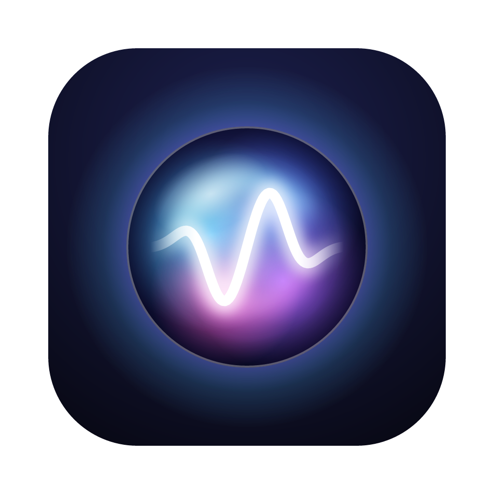

# DictateAI

Voice dictation for macOS that runs on your Mac. Hold a key, speak, and the text appears in whatever field you're typing in, cleaned up by a local AI model. No word limits, and nothing leaves your Mac unless you choose the optional cloud cleanup with your own OpenRouter key.

Apple Silicon only.

## Install

1. Download `DictateAI-<version>-arm64.dmg` from [Releases](https://github.com/ali050786/dictateai/releases), open it and drag **DictateAI** into **Applications**.
2. Open DictateAI. When macOS says it could not verify the app, click **Done**, then go to System Settings → Privacy & Security and click **Open Anyway**. The app is signed ad hoc, not notarized, and since macOS 15 right-click → Open no longer gets past this.
3. It lives in the menu bar (🎙), not the Dock. Allow **Accessibility** when macOS asks (System Settings → Privacy & Security → Accessibility → DictateAI). The dictation key starts working as soon as you allow it.
4. Allow the **Microphone** the first time you dictate.

Nothing else to install: the speech engines (Phonon and WhisperKit) and the cleanup engine (mlx-lm) ship inside the app. The first run downloads the models, with progress shown in Settings: about 160 MB for speech (646 MB if you dictate in a language Phonon doesn't cover, such as Hindi), and 1.7 GB (English) or 4.3 GB (other languages) for cleanup.

After rebuilding and reinstalling, macOS may ask for Accessibility again.

## Build

Building needs Homebrew's `whisperkit-cli` (copied into the app) and [uv](https://docs.astral.sh/uv/) (fetches the bundled Python, with mlx-lm and Phonon's `fermion-research`, minus the PyTorch it only needs on other platforms):

```bash
brew install whisperkit-cli
```

```bash
npm install && npm run make
```

`npm run make` runs `scripts/build-engines.sh` and writes `out/make/dmg/arm64/DictateAI-<version>-arm64.dmg`.

## Use

- **Hold** the dictation key (Right ⌥ Option by default; change it in the app) and speak. Release to insert the text.
- **Double-tap** for hands-free; tap again to stop.
- **Triple-tap** to undo the last dictation.
- **⌃⌘V** pastes your last dictation and **⌃⌘C** copies it. If nothing that takes text had focus when you finished speaking, the text waits for ⌃⌘V instead of being lost. Change these shortcuts, or add more, under Shortcuts.
- A soft tone plays when dictation starts and stops (Settings → Play sounds). Settings can also open DictateAI when you log in.

Settings, history and your dictionary are in the app window: click the menu-bar icon → Open DictateAI. Data is kept in `~/.dictateai` (readable only by you).

## Speech models

Settings → Speech model → **Automatic** picks by your dictation language:

| Language | Model | Download |
|---|---|---|
| English | Phonon-2 | 158 MB |
| Auto-detect, and 24 other European languages (French, German, Spanish, Russian, Ukrainian…) | Phonon-2.5 | 156 MB |
| Everything else (Hindi, Arabic, Japanese, Chinese…) | Whisper Large v3 Turbo | 646 MB |

Phonon transcribes 7.6 seconds of speech in about 0.15 s on an M-series Mac, and the words in your dictionary are passed to it as hotwords, so it favours your spellings of names and terms. Auto-detect only hears Phonon-2.5's languages; to dictate in Hindi, choose Hindi. Settings can also run Whisper (Small or Large v3 Turbo) for every language.

Phonon-2 and Phonon-2.5 are by [Fermion Research](https://www.fermionresearch.com/models/phonon-2/), derived from NVIDIA's Parakeet TDT 0.6B v3, and released under CC-BY-4.0. They run through the `fermion-research` package (Apache 2.0).

## Develop

```bash
npm run build:engines && npm start
```

Set `DICTATEAI_DEBUG=1` to log dictated text; by default logs show only its length.

`npm test` runs the unit tests (Node 23.6 or later, which runs TypeScript directly). The start and stop sounds are generated by `npm run build:sounds`.

## History

How this version was built, and why: [docs/sessions/2026-10-18-session.md](docs/sessions/2026-10-18-session.md).
